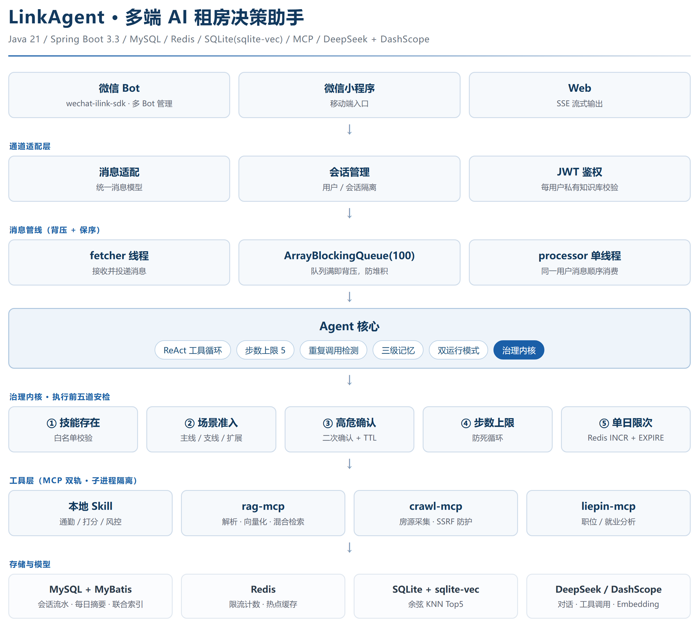
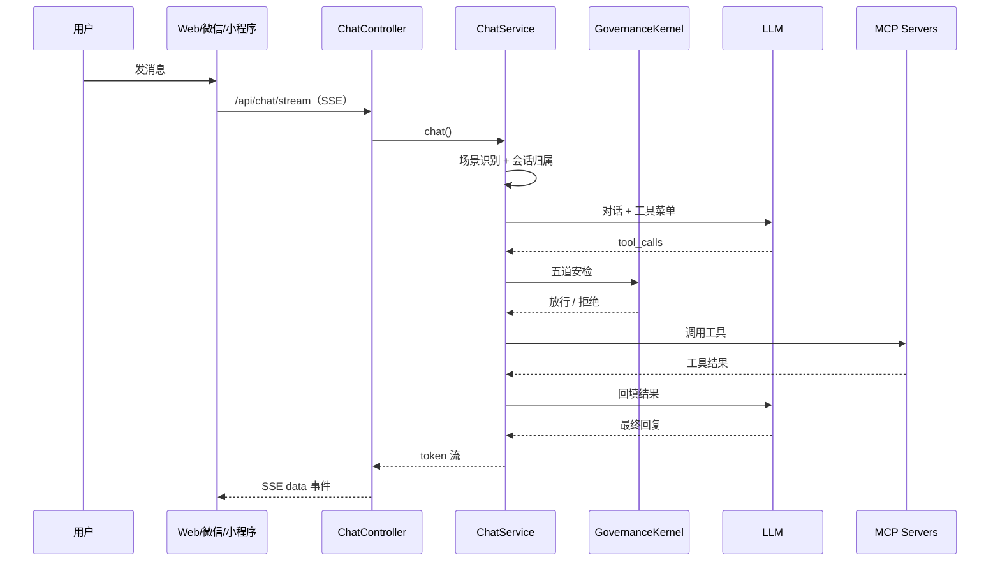
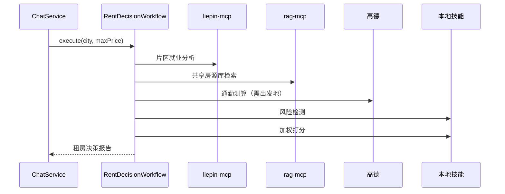

# LinkAgent（星链智核）

[](https://github.com/chen-249074185/LinkAgent/actions/workflows/ci.yml)


Java 单后端的多端 AI 智能助手：微信 + 小程序 + Web 三端接入，围绕 **MCP 工具编排、治理内核、RAG 知识库、租房决策工作流** 构建。

> 这个项目重点不是“接一个大模型聊天”，而是把 **工具调用做成可治理、可追踪、可扩展的工程系统**：五道安检、技能分层、MCP 双轨、SSE 流式、JWT 多租户、失败降级。

---

## 亮点

- **MCP 工具编排**：官方 Java MCP SDK，客户端 + 3 个独立 stdio Server（RAG / Crawl / 猎聘）+ 1 个远程 HTTP MCP（瑞幸）。
- **治理内核**：技能存在、场景白名单、高危操作确认、单轮步数上限、单日限次，五道安检后才允许执行。
- **技能三层**：MAIN（租房主线）/ SCENE（场景支线）/ EXT（架构扩展），主线工作流自动过滤无关工具。
- **双运行模式**：自由问答（任意原子技能单独调用）与任务工作流（完整租房需求全链路编排）。
- **工程化**：506 个主模块测试、GitHub Actions、JaCoCo、Actuator、traceId 全链路、Redis 故障降级。
- **可量化**：RAG 评测（City Recall@5 100%、约束查询 MRR 0.793、精确查询 MRR 0.984）+ 检索热路径压测（单线程 105.7 QPS），见 [`docs/RAG_EVAL.md`](docs/RAG_EVAL.md) / [`docs/PERFORMANCE.md`](docs/PERFORMANCE.md)。

---

## 功能

### 1. 租房决策工作流

完整需求（城市 + 预算 + 通勤）触发后，跳过 LLM 直接编排：

```
片区就业分析 → 共享房源检索 → 通勤测算 → 风险检测 → 加权打分 → 租房决策报告
```

- 房源来自链家采集，写入共享库 `kb-shared-houses`，全用户只读。
- 通勤测算需要出发地；工作流只带目的地，缺出发地时报告会明确提示，不编造坐标。
- 报告包含：就业、房源、通勤、风险、打分排行。

### 2. 自由问答 + 工具循环

- DeepSeek 对话 + tool_calls 循环；SSE 逐 token 推送。
- 工具结果回填后再次请求模型，直到给出最终回答。
- 高危工具（如下单）必须先回复“确认”，确认态 5 分钟有效、一次性使用。

### 3. 多端接入

| 端 | 实现 |
|---|---|
| 微信 | `wechat-ilink-sdk`，多 Bot 管理、扫码登录、会话恢复 |
| 小程序 | `agent/miniprogram`，首页 / 知识库 / 记忆 / 我的 |
| Web | `agent/src/main/resources/static`，对话、知识库、旅游、管理端 |

### 4. RAG 知识库

- 每用户私有知识库 + 全局共享房源库，写入/检索都校验归属。
- 文档解析：pdf / txt / md / docx / xlsx / pptx / csv。
- 混合检索：SQLite FTS5 关键词 + sqlite-vec 1024 维向量，RRF 融合；实测见 [`docs/RAG_EVAL.md`](docs/RAG_EVAL.md)。

### 5. 多模态与扩展能力

- DashScope：文生图、TTS、ASR、视觉理解、Embedding。
- 旅游规划：高德 POI + 分天排程 + 游记地图。
- 瑞幸远程 MCP、天气、文件解析、人格配置、邮箱验证码 / 账号合并。
- UU 跑腿报价：目前只有 Mock 占位技能 `uu_quote`，未接真实 UU API。
- 管理端：技能开关、RAG 管理、日志查看。
- 记忆：Redis 瞬时记忆（30 分钟）+ MySQL 短期记忆 + 每日摘要压缩。

---

## 架构



### 消息链路



### 工作流



---

## 技术栈

| 层 | 选型 |
|---|---|
| 语言 / 框架 | Java 21、Spring Boot 3.3.13、Maven 3.9.9 |
| LLM | DeepSeek（对话 + 工具调用）、DashScope（qwen / 文生图 / 语音 / Embedding） |
| MCP | 官方 Java MCP SDK 1.1.4：客户端 + RAG / Crawl / 猎聘 stdio Server + 瑞幸 HTTP |
| 存储 | MySQL + MyBatis、Redis、SQLite + sqlite-vec |
| 接入 | wechat-ilink-sdk、微信小程序、Spring MVC 静态页 |
| 文档 | SpringDoc OpenAPI（Swagger UI） |
| 部署 | Docker + docker-compose（MySQL / Redis / liepin-cli / app） |

---

## 工程实践

- **测试**：主模块 506 个用例，四模块合计 599 个（3 个评测/验收用例按条件跳过）；覆盖消息适配、场景识别、工作流、治理、RAG、旅游、采集等链路。
- **CI**：GitHub Actions 起 MySQL + Redis 服务，跑测试、打包四模块、构建 Docker 镜像。
- **可观测性**：`/actuator/health`、`/actuator/metrics`、`/actuator/prometheus`；请求级 `traceId` 写入日志和响应头。
- **故障降级**：Redis 不可用时，限流 / 确认态 / 瞬时记忆自动退回内存；MCP 不可用时接口返回明确错误，不拖垮主链路。
- **安全**：JWT 鉴权、BCrypt 密码、管理端 Token、高危操作确认、技能白名单、密钥全部走环境变量；猎聘 Token / 微信 botToken / 会话恢复上下文用 **AES-256-GCM 加密后入库**（`enc:v1:` 前缀，带字段级 AAD，防篡改与跨字段搬运）。

---

## 快速开始

### 方式一：Docker（推荐）

```bash
cp .env.example .env    # 至少填 DEEPSEEK_API_KEY / DASHSCOPE_API_KEY / MYSQL_PASSWORD / JWT_SECRET
docker compose up -d --build
```

启动后：

- Web：<http://localhost:8080/>
- Swagger：<http://localhost:8080/swagger-ui.html>
- 健康检查：<http://localhost:8080/actuator/health>

> 首次启动会自动建表并灌入 34 城房源。微信 Bot 在容器内默认关闭（扫码需要控制台），Web / 小程序可正常用。

### 方式二：本地开发

1. 准备 JDK 21、Maven 3.9+、MySQL 8、Redis 7。
2. `cp .env.example .env`，填密钥。
3. 建表：`mysql -uroot -p < deploy/mysql/init.sql`
4. 启动：`cd agent && ./mvnw spring-boot:run`
5. 打开 <http://localhost:8080/swagger-ui.html>

### 方式三：Mock 模式（无需 LLM / MCP Key，仍需 MySQL）

```properties
linkagent.workflow.mock-enabled=true
linkagent.redis-enabled=false
```

Mock 模式用 4 个占位技能跑通工作流，适合看编排逻辑；真实 MCP 需要对应 jar 和密钥。

---

## 配置

所有密钥走环境变量 / `.env`，零明文入库：

| 变量 | 用途 |
|---|---|
| `DEEPSEEK_API_KEY` | 对话 + 工具调用 |
| `DASHSCOPE_API_KEY` | qwen / 文生图 / 语音 / Embedding |
| `AMAP_KEY` | 通勤、POI、地理编码 |
| `AMAP_JS_KEY` / `AMAP_JS_SECURITY_CODE` | Web 地图（可选） |
| `SENIVERSE_API_KEY` | 天气 |
| `MYSQL_PASSWORD` | MySQL |
| `JWT_SECRET` | JWT 签名（HS256 ≥ 32 字节） |
| `FIELD_ENCRYPTION_KEY` | 敏感字段落库加密（AES-256-GCM）；留空回退 JWT_SECRET 派生 |
| `ADMIN_TOKEN_WEB` | 管理端 |
| `LIEPIN_USER_TOKEN` | 猎聘（可选） |
| `LUCKIN_MCP_TOKEN` | 瑞幸 MCP（可选） |

---

## 测试

```bash
# 主模块
mvn -pl agent test

# 四模块打包（跳过测试）
mvn -DskipTests package
```

> Redis 相关集成测试需要本地 Redis；CI 里通过 service 容器提供。RAG 子模块的原生 `vec0` 扩展按平台区分（Windows `vec0.dll` / Linux `vec0.so`）。

---

## 已知限制

- **单机设计**：SQLite 单写、图片存本地、治理计数在 JVM 内存；多实例部署需要迁移到 pgvector / 对象存储 / Redis 状态。
- **文件版会话仍是明文**：`sessions/*.session`（仅供手动 main 扫码链路）没有走 FieldCipher，因为没有 Spring 容器；Spring 链路已全部加密。
- **检索是单连接**：混合检索已实现，但 SQLite 读路径串行化；8 并发下 p95 会明显升高，见性能文档。
- **通勤需要出发地**：工作流只带目的地，缺出发地时报告会提示用户补充。
- **爬虫合规**：链家 / 猎聘采集仅用于学习与个人求职，请遵守目标站点条款并控制频率。
- **微信 Bot**：容器内默认关闭，需要本机扫码登录。
- **UU 跑腿**：只有 Mock 占位，没有真实询价/下单能力。

---

## 目录结构

```
agent/                  Spring Boot 主服务
  src/main/java/com/star/agent/
    adapter/            Web / 微信 / 消息适配
    workflow/           工作流引擎 + 租房决策编排
    mcp/                MCP 客户端接入 + 房源采集
    skill/              技能契约与实现（MAIN / SCENE / EXT）
    governance/         治理内核：五道安检 + 限流 + 确认
    llm/                LLM 统一接口（DeepSeek / DashScope）
    memory/             瞬时 / 短期 / 摘要记忆
    media/              文生图 / TTS / ASR / 视觉
    travel/             旅游规划 + 游记
    user/               JWT / 邮箱 / 微信 / 人格
  miniprogram/          微信小程序
rag-mcp/                RAG MCP Server（SQLite + sqlite-vec）
crawl-mcp/              爬虫采集 MCP Server（链家）
liepin-mcp/             猎聘 CLI 包装 MCP Server
mcp/liepin-cli/         vendored 猎聘 CLI 源码（构建/运行依赖）
deploy/                 MySQL 初始化脚本
docs/                   架构 / API / 框架 / 适配层 / 稳定性文档
```

---

## 文档

- [`docs/ARCHITECTURE.md`](docs/ARCHITECTURE.md)：架构设计与技术决策
- [`docs/API.md`](docs/API.md)：REST API
- [`docs/FRAMEWORK.md`](docs/FRAMEWORK.md)：双模式 / 技能三层 / Mock 切换
- [`docs/ADAPTER.md`](docs/ADAPTER.md)：通道适配层
- [`docs/STABILITY.md`](docs/STABILITY.md)：稳定性与降级策略
- [`docs/RAG_EVAL.md`](docs/RAG_EVAL.md)：RAG 评测方法与结果
- [`docs/PERFORMANCE.md`](docs/PERFORMANCE.md)：检索热路径压测结果

---

## Roadmap

- [ ] SQLite 读连接池 + WAL（当前 8 并发 p95 偏高）
- [ ] pgvector / MinIO 多实例部署
- [ ] 治理状态 Redis 化
- [ ] Agent 工具调用成功率评测
- [ ] 演示视频与在线 Demo

---

## License

[MIT](LICENSE)
